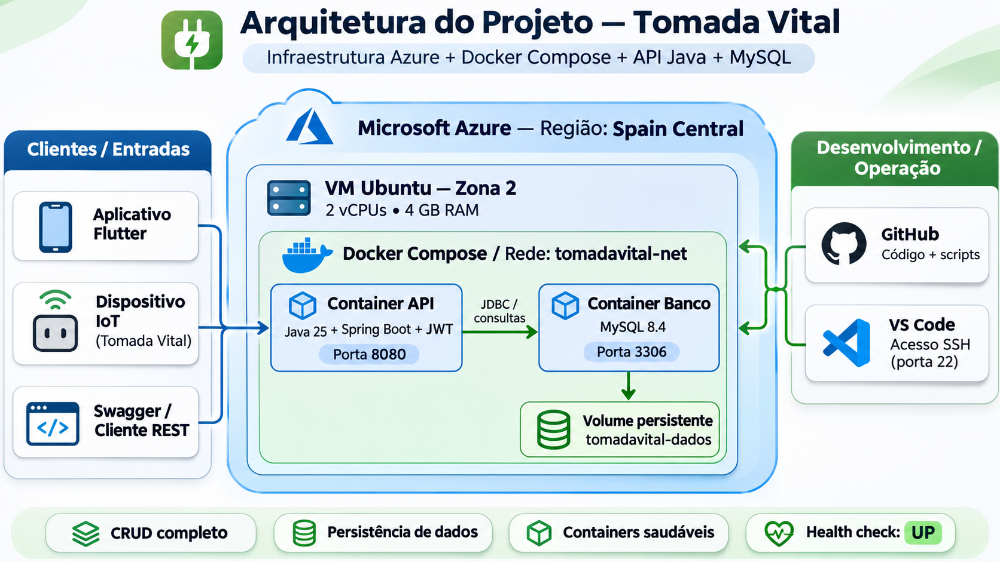
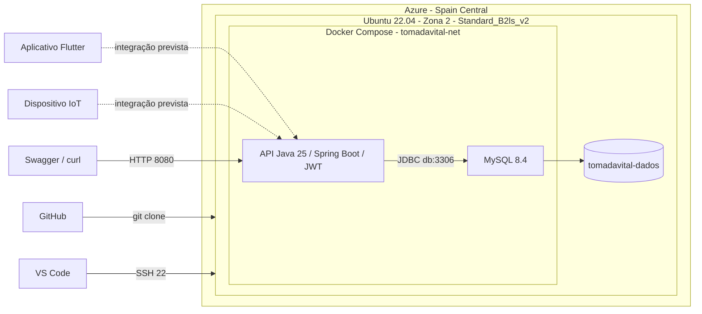

# Tomada Vital — DevOps & Cloud Computing

**Global Solution 2026/2 — FIAP | CitizenTech**  
**Disciplina:** DevOps Tools & Cloud Computing  
**Turma:** 2TDSPR

## Integrantes

| Integrante | RM |
| --- | --- |
| Diego Paulino | 566841 |
| Guilherme Dabul | 559901 |
| Renan Lima | 568321 |
| Ryan Mazali | 567168 |
| Thiago Alexandre | 567486 |

**Responsável pela entrega DevOps:** Thiago Alexandre.  
**API Java original:** [DiegoCPaulino/API-Tomada-Vital](https://github.com/DiegoCPaulino/API-Tomada-Vital).

## Sobre a solução

A Tomada Vital propõe apoiar famílias de pacientes que dependem de equipamentos elétricos em situações de falta de energia. A API recebe alertas, calcula a autonomia restante dos aparelhos e organiza a fila de atendimento pela urgência. Esta entrega demonstra a infraestrutura de uma prova de conceito: API Java e MySQL em dois containers integrados, em uma VM Linux no Azure.

Docker padroniza a execução e isola os serviços; Docker Compose organiza rede, dependência, variáveis e armazenamento. O Azure permite provisionar a infraestrutura por CLI e disponibilizar a API para clientes externos. Não se trata de um sistema médico ou de produção validado.

## Arquitetura macro



O diagrama representa o ecossistema proposto. As integrações com o aplicativo Flutter e o dispositivo IoT são previstas, não foram validadas nesta entrega. A porta 3306 do MySQL é interna à rede Docker; somente a API publica a porta 8080. O acesso administrativo usa SSH (22).



## Tecnologias e infraestrutura

| Componente | Configuração |
| --- | --- |
| Cloud | Microsoft Azure, Spain Central (`spaincentral`), zona 2 |
| VM | `vm-tomadavital`, `Standard_B2ls_v2`, 2 vCPUs, 4 GiB RAM, Ubuntu 22.04 LTS |
| Docker / Compose na VM | Docker Engine 29.10.0 / Compose v5.7.1 (verificados em 16/11/2026) |
| API | Java 25, Spring Boot 4.1.2, Maven Wrapper, Spring Security/JWT, JPA, Actuator, Swagger |
| Banco | MySQL 8.4 (8.4.13 observado nos logs) |
| Imagem / containers | `tomadavital-api:1.0`, `tomadavital-api`, `tomadavital-db` |
| Rede | `tomadavital-net` (bridge) |
| Volume | `tomadavital-dados` montado em `/var/lib/mysql` |
| Segurança | API com usuário `tomadavital`, WORKDIR `/app`; processo MySQL com UID 999 (`mysql`); banco sem porta publicada |

## Estrutura do repositório

```text
.
├── src/                    # Código-fonte da API Java
├── pom.xml
├── mvnw / mvnw.cmd
├── Dockerfile              # Build multi-stage da API
├── docker-compose.yml      # API, MySQL, rede, volume e healthcheck
├── .dockerignore
├── .env.example            # Modelo sem credenciais reais
├── deploy-azure.sh         # Provisionamento Azure CLI
├── destroy-azure.sh        # Exclusão dos recursos
├── COMO-RODAR-NA-VM.md      # Guia complementar (verificar valores atuais neste README)
├── docs/
│   ├── arquitetura.png
│   └── evidencias/
└── README.md
```

## How To — execução local

Pré-requisitos: Git, Docker Engine ou Docker Desktop com Compose v2 ou superior, Bash (Linux, macOS, WSL ou Git Bash) para os comandos abaixo, e OpenSSL/Python 3 para os exemplos. O Java é compilado dentro da imagem; não é necessário instalar o JDK localmente para usar Docker.

```bash
git clone https://github.com/thiagoalexandre10/tomadavital-devops.git
cd tomadavital-devops
```

Crie o `.env` **somente na primeira execução** (não sobrescreva as credenciais de um banco existente):

```bash
umask 077
cat > .env <<ENV
DB_NAME=tomadavital
DB_USER=tomadavital
DB_PASSWORD=$(openssl rand -hex 16)
DB_ROOT_PASSWORD=$(openssl rand -hex 16)
JWT_SECRET=$(openssl rand -hex 32)
ENV
chmod 600 .env
git check-ignore .env
docker compose config --quiet
```

No Windows PowerShell, alternativamente use `Copy-Item .env.example .env` e edite o arquivo localmente com senhas fortes diferentes e um segredo JWT de pelo menos 32 caracteres. Nunca publique `.env`.

```bash
docker compose up -d --build
docker compose ps
curl -fsS http://localhost:8080/actuator/health
```

O MySQL deve ficar `healthy`, a API deve ficar em execução e o Actuator deve retornar `UP`. A carga inicial pode levar algum tempo após a inicialização.

## How To — provisionamento no Azure

Pré-requisitos: assinatura Azure ativa, Azure CLI autenticada (por exemplo, Azure Cloud Shell em Bash), Git e quota disponível. A execução cria recursos cobrados ou descontados dos créditos da assinatura.

```bash
az account show --query '{Nome:name,Estado:state}' -o table
az vm list-skus --location spaincentral --size Standard_B2ls_v2 --all -o table
az vm list-usage --location spaincentral -o table
git clone https://github.com/thiagoalexandre10/tomadavital-devops.git
cd tomadavital-devops
bash deploy-azure.sh
```

O script cria o grupo `rg-tomadavital-RM567486`, cria a VM, libera a porta 8080 e instala Docker/Compose. A zona 2 foi escolhida devido à restrição observada na zona 1. Consulte o IP público retornado pelo script:

```bash
az vm show -d -g rg-tomadavital-RM567486 -n vm-tomadavital --query publicIps -o tsv
```

### Comandos Azure CLI usados pelo script

```bash
az group create --name rg-tomadavital-RM567486 --location spaincentral
az vm create --resource-group rg-tomadavital-RM567486 --name vm-tomadavital --location spaincentral --image Ubuntu2204 --size Standard_B2ls_v2 --zone 2 --admin-username azureuser --generate-ssh-keys --public-ip-sku Standard
az vm open-port --resource-group rg-tomadavital-RM567486 --name vm-tomadavital --port 8080
az vm run-command invoke --resource-group rg-tomadavital-RM567486 --name vm-tomadavital --command-id RunShellScript --scripts 'curl -fsSL https://get.docker.com | sh && usermod -aG docker azureuser'
```

Use o script **ou** os comandos equivalentes, não ambos. Em Cloud Shell temporário, preserve a chave SSH privada em local seguro ou cadastre a chave pública do seu computador no Azure (VM > Redefinir senha > Adicionar chave pública SSH). Nunca publique a chave privada.

### Deploy dentro da VM

```bash
ssh azureuser@IP_PUBLICO
```

Se for utilizar uma chave local no Windows, conecte pelo terminal do VS Code com `ssh -i "$env:USERPROFILE\.ssh\tomadavital_nova" azureuser@IP_PUBLICO`, ajustando o nome do arquivo conforme a sua chave.

Já conectado à VM:

```bash
hostname
docker --version
docker compose version
git clone https://github.com/thiagoalexandre10/tomadavital-devops.git
cd tomadavital-devops
```

Crie o `.env` conforme a seção anterior, apenas se ele ainda não existir. Em seguida:

```bash
docker compose config --quiet
docker compose up -d --build
docker compose ps
curl -fsS http://localhost:8080/actuator/health
```

Substitua `IP_PUBLICO` pelo IP obtido do Azure para acessar externamente:

| Serviço | URL |
| --- | --- |
| Swagger | `http://IP_PUBLICO:8080/swagger-ui/index.html` |
| OpenAPI | `http://IP_PUBLICO:8080/v3/api-docs` |
| Health | `http://IP_PUBLICO:8080/actuator/health` |

IP utilizado na demonstração: `158.158.19.200` (pode mudar ao recriar a VM). HTTP sem TLS é somente para demonstração com dados fictícios. Não inserir dados de pacientes reais; restringir acesso e configurar HTTPS antes de qualquer uso real.

## Dockerfile e Docker Compose

O Dockerfile compila a API em uma etapa com `eclipse-temurin:25-jdk` e copia o JAR para a imagem de execução `eclipse-temurin:25-jre`. O container final usa `WORKDIR /app`, `USER tomadavital`, `EXPOSE 8080`, perfil `docker` e `java -jar app.jar`. O build usa `-DskipTests`; não equivale a executar testes unitários.

O Compose configura dois serviços, `api` e `db`, conectados à mesma rede. O `depends_on` aguarda o healthcheck do MySQL. As credenciais são fornecidas por variáveis de ambiente e o banco usa o volume nomeado. A API publica `8080:8080`; o MySQL usa `expose: 3306`, sem publicação da porta no host.

```bash
docker compose ps
docker compose images
docker compose logs --tail=30 api
docker compose logs --tail=15 db
docker compose exec api whoami
docker compose exec api pwd
docker compose exec db sh -c 'grep "^Uid:" /proc/1/status; id mysql'
```

Para abrir um shell/comando como o usuário do banco e no diretório de dados, use:

```bash
docker compose exec --user mysql --workdir /var/lib/mysql db pwd
docker network ls
docker volume ls
```

A imagem oficial MySQL inicia o entrypoint como root e reduz privilégios para `mysql`. O PID 1 foi comprovado com UID 999. O usuário e o WORKDIR padrão da imagem continuam root e `/`; não alegamos que esses padrões foram modificados. O caminho de dados é `/var/lib/mysql`.

## CRUD e autenticação

A carga inicial fornece usuários fictícios de demonstração. Para detalhes de papéis, endpoints, regras e entidades, consulte o [README da API original](https://github.com/DiegoCPaulino/API-Tomada-Vital#readme).

Execute dentro da VM para que as requisições usem localhost. O login usa HTTP Basic e retorna JWT; o token é mantido em variável de sessão e não deve ser publicado. A senha fictícia padrão consta na documentação da API. O comando abaixo solicita a senha sem exibi-la.

```bash
BASE=http://localhost:8080
TOKEN=$(curl -fsS -X POST -u familia1 "$BASE/autenticacao/login" | python3 -c 'import sys,json; print(json.load(sys.stdin)["accessToken"])')
```

### Criar, consultar e atualizar um paciente

```bash
PACIENTE=$(curl -fsS -X POST "$BASE/api/pacientes" -H "Authorization: Bearer $TOKEN" -H 'Content-Type: application/json' -d '{"nome":"Paciente Teste DevOps","bairro":"Parque Pinheiros","cidade":"Taboao da Serra","telefone":"11900000000"}')
PID=$(printf '%s' "$PACIENTE" | python3 -c 'import sys,json; print(json.load(sys.stdin)["id"])')
printf 'Paciente criado: %s\n' "$PID"
curl -sS -i "$BASE/api/pacientes/$PID" -H "Authorization: Bearer $TOKEN"
curl -sS -i -X PUT "$BASE/api/pacientes/$PID" -H "Authorization: Bearer $TOKEN" -H 'Content-Type: application/json' -d '{"nome":"Paciente Teste DevOps Atualizado","bairro":"Parque Pinheiros","cidade":"Taboao da Serra","telefone":"11900000001"}'
```

### Cadastrar equipamento relacionado

Escolha um código `TV-000` ainda não cadastrado; `TV-098` é um exemplo, não uma garantia de disponibilidade.

```bash
curl -sS -i -X POST "$BASE/api/equipamentos" -H "Authorization: Bearer $TOKEN" -H 'Content-Type: application/json' -d "{\"pacienteId\":$PID,\"tipo\":\"CONCENTRADOR_O2\",\"autonomiaMinutos\":480,\"codigoDispositivo\":\"TV-098\"}"
```

### DELETE — registro temporário

Crie um paciente fictício separado, sem equipamentos, e exclua apenas esse ID:

```bash
TEMP=$(curl -fsS -X POST "$BASE/api/pacientes" -H "Authorization: Bearer $TOKEN" -H 'Content-Type: application/json' -d '{"nome":"Paciente Temporario Delete","bairro":"Centro","cidade":"Sao Paulo","telefone":"11900000002"}')
TID=$(printf '%s' "$TEMP" | python3 -c 'import sys,json; print(json.load(sys.stdin)["id"])')
printf 'ID temporario: %s\n' "$TID"
curl -sS -i -X DELETE "$BASE/api/pacientes/$TID" -H "Authorization: Bearer $TOKEN"
```

Resultados esperados: POST 201, GET 200, PUT 200 e DELETE 204. O login e o CRUD via curl foram validados. O Swagger abriu publicamente e o login retornou 200; o CRUD protegido pelo Swagger foi validado com sucesso após a renovação do token JWT. Para usar o Swagger, autorize `basicAuth`, execute `POST /autenticacao/login`, depois cole apenas o valor de `accessToken` em `bearerAuth` (sem aspas nem prefixo Bearer). Nunca mostre o token em evidências.

## SELECT e persistência

Os testes realizados em 17/11/2026 registraram paciente ID 11 e equipamento ID 12 (`TV-099`, paciente_id 11). Substitua `11` pelo ID do seu próprio teste em uma nova implantação.

```bash
docker compose exec db sh -c 'mysql -u "$MYSQL_USER" -p"$MYSQL_PASSWORD" "$MYSQL_DATABASE" -e "SHOW TABLES; SELECT * FROM paciente WHERE id=11; SELECT * FROM equipamento WHERE paciente_id=11;"'
```

O comando utiliza a senha do ambiente do container. O cliente MySQL emite um aviso por usar senha na linha de comando; não é erro SQL.

Para comprovar a persistência, remova e recrie os containers e repita os SELECTs:

```bash
docker compose down
docker volume ls
docker compose up -d
docker compose ps
docker compose exec db sh -c 'mysql -u "$MYSQL_USER" -p"$MYSQL_PASSWORD" "$MYSQL_DATABASE" -e "SELECT * FROM paciente WHERE id=11; SELECT * FROM equipamento WHERE paciente_id=11;"'
curl -fsS http://localhost:8080/actuator/health
```

Execute a última consulta HTTP após a API estar pronta. **Não use `docker compose down -v`**, pois removeria o volume persistente. O teste comprovou a conservação dos registros após recriação dos containers, não após exclusão da VM ou do grupo de recursos.

## Evidências da execução

| Evidência | Arquivo |
| --- | --- |
| Deploy na VM e dois containers | [01-deploy.png](docs/evidencias/01-deploy.png) |
| Actuator público UP | [02-health.png](docs/evidencias/02-health.png) |
| POST e consulta de pacientes | [03-cadastro.png](docs/evidencias/03-cadastro.png) |
| Atualização e equipamento relacionado | [04-atualizacao-e-equipamento.png](docs/evidencias/04-atualizacao-e-equipamento.png) |
| SELECT em duas tabelas | [05-select.png](docs/evidencias/05-select.png) |
| Persistência após recriação | [06-persistencia.png](docs/evidencias/06-persistencia.png) |
| Usuário e WORKDIR da API, rede e volume | [07-rede-volume.png](docs/evidencias/07-rede-volume.png) |
| UID do processo MySQL e saúde da API | [08-mysql-uid.png](docs/evidencias/08-mysql-uid.png) |

O CRUD completo pelo Swagger foi validado e demonstrado na apresentação em vídeo.

## Encerramento e custos

Após gravar e confirmar que não será necessário manter a infraestrutura ativa, execute no Cloud Shell (na pasta do repositório):

```bash
bash destroy-azure.sh
```

Ou exclua o grupo explicitamente por Azure CLI:

```bash
az group delete --name rg-tomadavital-RM567486 --yes
```

A exclusão do grupo apaga os recursos e pode apagar os dados armazenados na VM. Guarde as evidências e qualquer backup necessário antes. Para uma pausa temporária, desalocar a VM reduz o custo de computação, mas discos e outros recursos podem continuar cobrados. Recrie a infraestrutura para a apresentação, se exigido.

## Vídeo demonstrativo

[Assista à apresentação da Tomada Vital — DevOps Tools & Cloud Computing](https://www.youtube.com/watch?v=f5_2EsWOMYg) O PDF final de entrega deve conter nome da solução, integrantes, RMs, turma e links do GitHub e vídeo.

## Repositório

[github.com/thiagoalexandre10/tomadavital-devops](https://github.com/thiagoalexandre10/tomadavital-devops)

